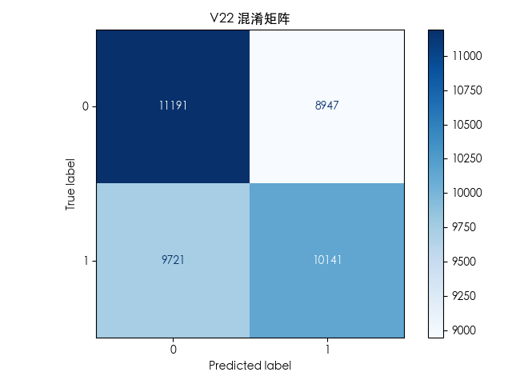

# 移动端广告点击数据挖掘

基于脱敏的移动端广告曝光日志，完成**分类预测、回归预测、关联规则挖掘与数据可视化**四类数据挖掘任务。项目为单脚本实现，代码集中在 [`analysis.py`](analysis.py)。

## 项目简介

数据字段已脱敏为 `V1`–`V22`，覆盖 IP、App/广告位哈希 ID、设备型号、系统版本、User-Agent、日期等维度：

- **V22**：二分类目标（0/1），用于点击/未点击预测；
- **V20**：连续型目标，用于回归分析；
- 其余字段作为特征，包含数值型与类别型（哈希 ID、设备信息、UA 等）。

脚本会依次完成数据加载、预处理、分类、回归、关联规则和可视化，结果打印到控制台并保存图表到 `figs/`。

## 数据集

| 项目 | 说明 |
| --- | --- |
| 文件 | `data/case_data.csv` |
| 规模 | 1,704,155 行 × 23 列（约 596 MB） |
| 索引列 | 首列 `Unnamed: 0` 为 pandas 导出的行索引，加载时自动删除 |
| 特征 | `V1`–`V21`，含数值、哈希 ID、设备/系统/UA 等类别字段 |
| 目标 | `V22`（二分类）、`V20`（回归） |
| 缺失情况 | 多个字段存在大量缺失（如 `V14`、`V15`、`V20`） |

> `V20` 中混有 `%5bOS%5d`、`__OS__` 等非数值占位符，回归任务会先转为数值并剔除无法转换的行。

## 项目结构

```
ShuJuWaJueKeShe/
├── analysis.py          # 主分析脚本
├── data/
│   └── case_data.csv    # 原始数据（约 596 MB）
├── figs/                # 运行后生成的图表
└── README.md
```

## 环境与依赖

- Python 3.11
- pandas、numpy
- scikit-learn
- matplotlib、seaborn
- mlxtend（Apriori 关联规则）

安装依赖：

```bash
python -m venv .venv
source .venv/bin/activate        # Windows: .venv\Scripts\activate
pip install pandas numpy scikit-learn matplotlib seaborn mlxtend
```

> 若直接使用仓库内的 `.venv`，需先补装 `scikit-learn` 与 `mlxtend`。

## 运行方式

在项目根目录执行（脚本使用相对路径读取 `data/case_data.csv`、写入 `figs/`）：

```bash
python analysis.py
```

## 分析流程

### 1. 数据加载

`load_data()` 读取 CSV，并删除 `Unnamed: 0` 索引列。

### 2. 预处理

`build_preprocessor()` 按列类型构建 `ColumnTransformer`：

- 数值列：中位数填充；
- 类别列：众数填充 + `OneHotEncoder(handle_unknown="ignore")`。

所有任务共用该预处理流程，避免训练/测试信息泄漏。

### 3. 分类任务：预测 V22

- 随机抽样最多 20 万行（`random_state=42`），按标签分层划分 8:2；
- 逻辑回归（`max_iter=200`）；
- 输出混淆矩阵、`classification_report`，并保存混淆矩阵图到 `figs/v22_confusion_matrix.png`。

### 4. 回归任务：预测 V20

- 抽样最多 20 万行，`V20` 强制转数值并剔除缺失行；
- 线性回归；
- 输出 MAE 与 R²。

### 5. 关联规则挖掘

- 取全部类别字段，抽样 5,000 行；
- 将每行“列名=取值”作为事务项，构造 one-hot 矩阵；
- `Apriori`（`min_support=0.01`）+ `association_rules`（`lift ≥ 1.1`）；
- 按提升度排序输出前 10 条规则。

### 6. 可视化

`visualization_task()` 抽样 10,000 行，生成 5 类图表：

| 图表 | 内容 | 文件 |
| --- | --- | --- |
| 计数图 | `V22` 目标分布 | `figs/v22_count.png` |
| 直方图 | `V20` 分布（含 KDE） | `figs/v20_hist.png` |
| 箱线图 | `V19` 按 `V22` 分组 | `figs/v19_box.png` |
| 热力图 | 数值特征相关系数 | `figs/corr_heatmap.png` |
| 条形图 | `V14` 取值 Top10 频次 | `figs/v14_top10.png` |

### 输出示例



## 实现说明

- 为控制运行时间，分类/回归/关联/可视化均采用随机抽样；调整 `sample(n=...)` 中的样本量即可切换为更大规模分析。
- 关联规则的 `min_support` 与 `min_threshold` 可按需调低/调高，以获得更多或更少规则。
- 图表中文依赖系统字体，脚本已配置 `PingFang SC`、`Heiti SC`、`SimHei` 等候选字体，并关闭负号乱码。
- 当前模型均为基线模型（逻辑回归 / 线性回归），未做特征工程与超参数调优，可通过替换 Pipeline 中的 `model` 步骤扩展。
